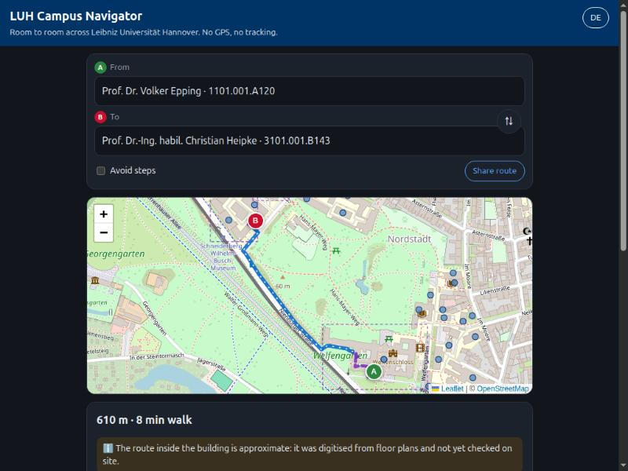
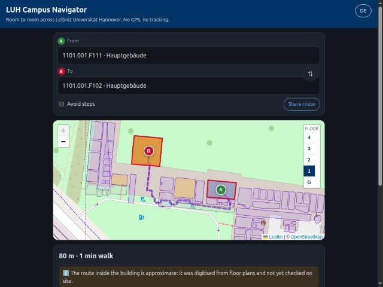
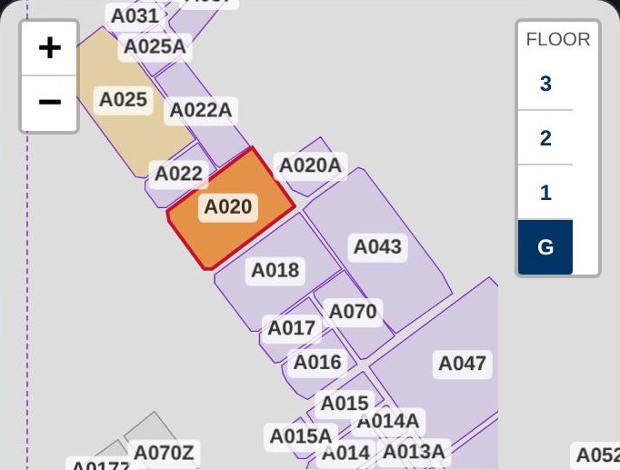

# LUH-Indoor-GIS-Navi

[](https://github.com/FreeXYZ-HalfPI/LUH-Indoor-GIS-Navi/actions/workflows/tests.yml)

A Free Software prototype of an indoor navigation system for Leibniz
Universität Hannover. It uses GIS data, graph-based routing and building
floor plans.

**From room XX in building YY → to room ZZ in building WW.** It runs in the
phone browser, with nothing to install, no GPS and no personal data.

## Project overview
Finding rooms inside university buildings is often hard for new students and
visitors. LUH's [Standortfinder](https://standortfinder.uni-hannover.de/de/)
shows *where* a building is, and [Rauminfo](https://info.cafm.uni-hannover.de/de/)
shows a floor plan with the room in red. Neither tells you *how to get there*:
which entrance, which way, which floor. Outdoor navigation ends at the building
door, and nobody guides you inside.

## Goal
Build an open-source navigation web app that routes students from one room to
another across the campus:

1. You enter where you are (a room or building code) and where you want to go.
2. The app computes the walking route **on your phone**, between the best
   building entrances, using OpenStreetMap footpaths.
3. It tells you the floor and wing of the target room and shows the official
   floor plan.
4. In **5 buildings** it already routes door to door: corridors, stairs and
   lifts, drawn on the floor plans (pilot, approximate): **1101 Hauptgebäude**,
   **3101 Schneiderberg-Gebäude** (IPI, GIH), **3109 Verfügungsgebäude** (IfE),
   **3408 Hochhaus Appelstraße** (IKG) and **3110 Hauptmensa**. The geodesy
   institutes IPI, GIH, IKG and IfE are the first targets.
5. Directions say **left, right or straight on**, and distances come in
   **steps** (an average adult step, 0.75 m) with the metres behind them:
   "Turn left, then walk 30 steps (23 m)." 

🚀 **Try it:** <https://freexyz-halfpi.github.io/LUH-Indoor-GIS-Navi/>
(examples: [Hauptgebäude E028 → TI-Gebäude 3703.001.107](https://freexyz-halfpi.github.io/LUH-Indoor-GIS-Navi/#from=1101.000.E028&to=3703.001.107),
[inside the Hauptgebäude, ground floor → 4th floor](https://freexyz-halfpi.github.io/LUH-Indoor-GIS-Navi/#from=1101.000.E028&to=1101.004.F407),
[lecture hall A104 → Hauptmensa 205A](https://freexyz-halfpi.github.io/LUH-Indoor-GIS-Navi/#from=3101.001.A104&to=3110.002.205A))

## What works today

| Person to person | Room to room, door to door | Every room on the map, per floor |
|---|---|---|
|  |  |  |

- **2,035 rooms** in the mapped buildings so far, found by the room crawler
  (the Hochhaus 3408 is still being crawled). LUH Rauminfo lists only a few of
  them (the lecture and seminar rooms).
- **1,870 rooms (92%) are routable** door to door, across floors and buildings
  ([coverage per floor](docs/COVERAGE.md)).
- **Find people:** type a name instead of a room code ("Christian Heipke",
  even with a typo like "Eping" for Epping) and the app routes to their office.
  321 people of the Präsidium, 4 Dezernate and 13 institutes in 1101, 3101 and
  3109, read from the contact cards on public LUH pages (`tools/crawl_people.py`,
  no phone or e-mail); 318 of them door to door. IKG follows with the 3408 crawl.
- **Room explorer:** zoom in on a building with a purple dashed frame, pick a
  floor, tap any room and choose *Start here* / *Go here*. Public rooms show
  their type and size.

Try: [Prof. Heipke (IPI) → Prof. Flury (IfE)](https://freexyz-halfpi.github.io/LUH-Indoor-GIS-Navi/#from=christian-heipke&to=jakob-flury) ·
[the president's office → Prof. Heipke](https://freexyz-halfpi.github.io/LUH-Indoor-GIS-Navi/#from=volker-epping&to=christian-heipke) ·
[room A020 on the map](https://freexyz-halfpi.github.io/LUH-Indoor-GIS-Navi/#to=3101.000.A020) ·
[3rd-floor office in the Hauptgebäude → Mensa 2nd floor](https://freexyz-halfpi.github.io/LUH-Indoor-GIS-Navi/#from=1101.003.G315&to=3110.002.262) ·
[2nd-floor mezzanine F220 → 3101 attic A320](https://freexyz-halfpi.github.io/LUH-Indoor-GIS-Navi/#from=1101.002.F220&to=3101.003.A320)

### Crawl all rooms of a building

```bash
python3 tools/crawl_rooms.py https://info.cafm.uni-hannover.de/de/building/3101/rooms
python3 tools/build_indoor.py build 3101
python3 tools/coverage.py
```

People: `python3 tools/crawl_people.py` reads the pages listed in
[data/people_sources.json](data/people_sources.json).

The crawler guesses room numbers per floor and wing, keeps those that have a
CAFM floor plan, and reads each room's position and outline from its red
highlight. It is polite (one request at a time, cached, resumable). See
[data/README.md](data/README.md) and [docs/INDOOR_FORMAT.md](docs/INDOOR_FORMAT.md).

➡ Full idea: **[docs/CONCEPT.md](docs/CONCEPT.md)** · Plan: **[ROADMAP.md](ROADMAP.md)** ·
Data: **[docs/DATA_SOURCES.md](docs/DATA_SOURCES.md)**

## Principles
- 📱 **Mobile web app (PWA).** Open the link, optionally "Add to Home Screen".
  Works offline after the first visit.
- 🔒 **Privacy first.** No GPS, no accounts, no tracking. Routes are computed
  on the device.
- 🗺️ **Open data.** OpenStreetMap plus public LUH building and room data.
- 🆓 **Free Software.** [GNU GPL v3](LICENSE).

## Features
- [x] Indoor routing (5 buildings, approximate)
- [x] Turn-by-turn directions (left / right / straight on), distances in steps
- [x] Multi-floor buildings, stairs and lifts
- [x] Outdoor → indoor transition
- [x] All rooms of a building, not only the public ones (room crawler)
- [x] Room explorer on the map
- [x] Search for people: route to a person's office
- [x] Mobile interface, works offline
- [ ] QR-code positioning
- [ ] Accessible (step-free) routing with verified data ("Avoid steps" uses lifts today)
- [ ] Digital-twin integration
- [ ] International Office, Mensa and public services; directions for exchange
      students, event visitors, new students, people with disabilities
      ([future goals](ROADMAP.md#future-goals-written-down-not-started))

The user journey: *Where are you? → Where do you want to go? → exact address
of the classroom → best path → site plan oriented to where you are, with no
sensors and no IMU.*

## Repository layout
```
docs/    concept, architecture, data sources, indoor graph format
tools/   Python scripts that build the data (LUH rooms, room and people crawlers, OSM walk graph, indoor graphs, coverage)
tests/   offline tests for the tools and the generated data (python3 -m unittest discover tests)
web/     the static mobile web app (served by GitHub Pages)
data/    indoor sources per building, entrance overrides, raw cache (not committed)
```

## Run locally
```bash
python3 -m http.server 8000 --directory web
```
Then open <http://localhost:8000>.

## License
Copyright © 2026 Mohammad B. Saryazdi and contributors.
Licensed under the **GNU General Public License v3.0 or later**. See [LICENSE](LICENSE).

Map data © [OpenStreetMap](https://www.openstreetmap.org/copyright) contributors (ODbL).
Building and room data and floor plans © Leibniz Universität Hannover.
